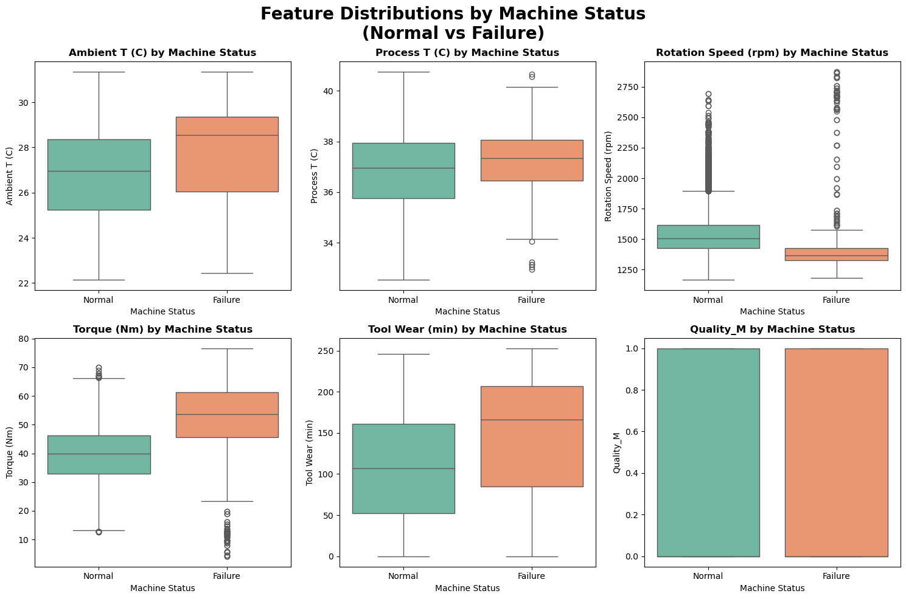
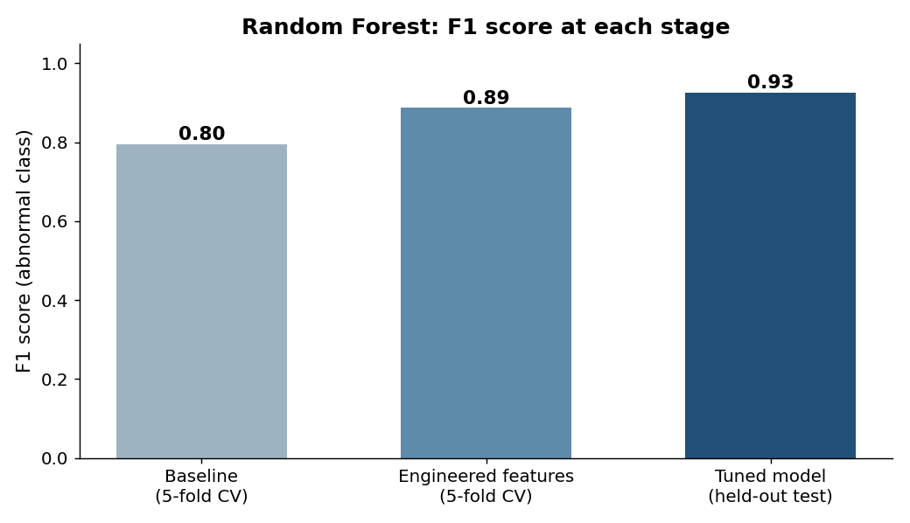

# Machine Failure Prediction

Predicting whether a factory machine is running normally or abnormally from its sensor readings, using scikit-learn.

## The problem

The dataset has 20,000 machine readings: air and process temperature, rotation speed, torque, tool wear and product quality (low, medium or high). Only **3.4% of readings are abnormal**, so a model that always predicts "normal" would be 96.6% accurate and completely useless. I used **F1 score** on the abnormal class as the main metric instead of accuracy.

## Approach

1. **Exploratory data analysis:** distributions, box plots and correlations, split by machine status, to see which readings differ when a machine fails. Failing machines run at higher torque, lower rotation speed and with more tool wear:

   

2. **Baseline models:** compared Random Forest, HistGradientBoosting and Extra Trees with 5-fold cross-validation. The tree models used balanced class weights to handle the imbalance.
3. **Feature engineering:** added three features based on how machines physically behave:
   - **Mechanical stress** = torque × rotation speed
   - **Power (W)** = torque × rotation speed × 2π/60
   - **Temperature differential** = process temperature − air temperature
4. **Hyperparameter tuning:** randomized search over the Random Forest's tree count, depth, split and leaf sizes, and feature sampling.
5. **Final evaluation** on a held-out test set that wasn't used for any training or tuning.

## Results

| Stage | Model | F1 (abnormal class) |
|---|---|---|
| Baseline, 5-fold CV | Random Forest | 0.80 |
| After feature engineering, 5-fold CV | Random Forest | 0.89 |
| **Tuned, held-out test set** | **Random Forest** | **0.93** (precision 0.96, recall 0.89) |



Feature engineering gave the biggest jump: +0.09 F1 for the Random Forest.

## What I learned

- With imbalanced data, accuracy hides failure. Choosing the right metric comes first.
- Features grounded in how the system works (stress, power, heat) beat throwing raw columns at a model.
- Keeping the test set untouched until the very end gives a result you can trust.

## What I'd improve

- Mechanical stress and power are the same quantity at different scales, so one of them is redundant.
- Tune the decision threshold to catch more failures (higher recall), since missing a failing machine usually costs more than a false alarm.
- Use a scikit-learn `Pipeline` so preprocessing and the model are fitted together.

## Run it

```bash
pip install -r requirements.txt
jupyter notebook machine_failure_prediction.ipynb
```

The notebook keeps its outputs, so you can read the charts and results without running it.

## Data

`data/factory_data.csv` holds 20,000 machine readings. It appears to be adapted from the public [AI4I 2020 Predictive Maintenance Dataset](https://archive.ics.uci.edu/dataset/601/ai4i+2020+predictive+maintenance+dataset) (UCI).
